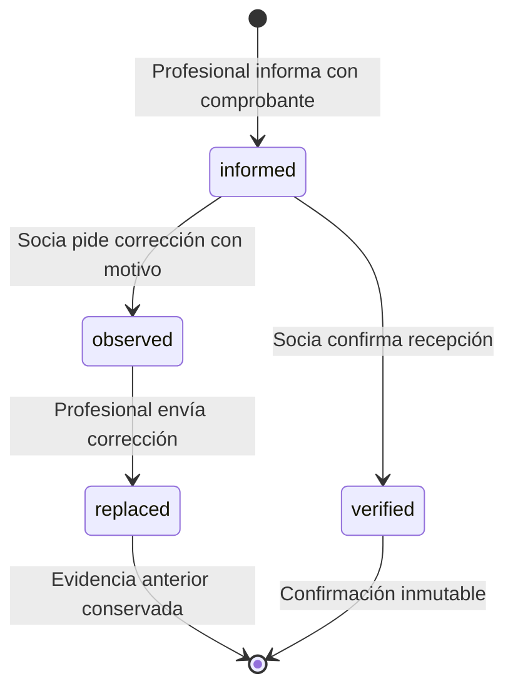

# Revisión funcional del prototipo

## Fuente y criterio

Se revisaron la aplicación efectiva en `../Hamacar/dist/index.html`, los scripts de pacientes, agenda, liquidaciones y exportación, los workers de voz, los assets y la documentación funcional incluida en el proyecto original. El prototipo mezcla HTML, estilos, funciones globales y estado mutable. Algunas modificaciones posteriores redefinen funciones anteriores, de modo que una lectura aislada de la primera definición no describe el comportamiento final.

Se tomó como referencia el snapshot funcional v13 y sus ajustes posteriores vigentes en el código, especialmente la separación entre importe cargado y transferencia confirmada. Los documentos anteriores no se trataron como especificaciones simultáneas cuando contradicen esos ajustes. No se agregó un módulo nuevo de acompañamiento terapéutico ni funcionalidades de documentos de planificación que no existen en la aplicación efectiva.

## Matriz de permisos

| Operación                                  | Socia                                                | Profesional                                         |
| ------------------------------------------ | ---------------------------------------------------- | --------------------------------------------------- |
| Ver ficha e historia compartida            | Todos los pacientes                                  | Solo pacientes asignados                            |
| Crear paciente                             | Sí; se autoasigna                                    | Sí; se autoasigna                                   |
| Editar ficha activa o en pausa             | Sí                                                   | Si está asignada                                    |
| Asignar equipo, pausar, archivar/reactivar | Sí                                                   | No                                                  |
| Leer notas privadas                        | Solo las propias                                     | Solo las propias                                    |
| Reservar                                   | Para cualquier integrante y sus pacientes            | Solo para sí y sus pacientes                        |
| Ver reservas ajenas                        | Identidad y horario                                  | Horario y profesional; paciente oculto              |
| Modificar reserva                          | Cualquier reserva futura                             | Solo las propias futuras                            |
| Cargar períodos/cobros/transferencias      | No tiene liquidaciones propias ni carga por terceros | Solo operaciones propias                            |
| Consultar economía                         | Todas las profesionales                              | Solo la propia, incluso si cambia el equipo clínico |
| Observar o confirmar transferencias        | Sí                                                   | No                                                  |
| Panel y exportación global                 | Sí                                                   | No                                                  |

Los diez accesos demo se conservaron. Las socias son Antonela, Celina y Estefanía. Los datos clínicos y económicos iniciales son ficticios; hay cinco pacientes y siete profesionales que liquidan.

## Pacientes e historia

- Alta con asignación a la usuaria que la realiza. Nombre e ingreso obligatorios; nacimiento e ingreso deben ser fechas válidas y coherentes.
- Coincidencia de nombre normalizada: advertencia y confirmación explícita, sin prohibir homónimos. Si la ficha coincidente es ajena, la advertencia no revela nombre, ID ni datos clínicos adicionales.
- `Activo`, `En pausa`, `Archivado`. Un cambio de estado requiere motivo; no puede quedar un paciente sin integrantes válidos asignados.
- Archivar no borra historia, documentos, reservas ni economía. Se bloquea la creación/edición de información clínica y de nuevas reservas hasta reactivar. Las reservas existentes se conservan para gestión explícita.
- Historia compartida para el equipo. Notas privadas exclusivamente para su autora, también frente a otras socias. Borradores separados por usuaria, paciente y visibilidad.
- Registro con texto y/o adjuntos, fecha no futura. Hasta cinco archivos de 10 MB: PDF, Word, JPG o PNG. Los adjuntos nuevos se pueden consultar/descargar durante la sesión.
- El dictado es una ayuda para redactar: la usuaria revisa y publica el texto. No hay envío de audio a un servicio de transcripción. La primera preparación sí descarga código/modelo de terceros, igual que el prototipo.

## Agenda

- Tres consultorios, vistas día/semana/mes y filtros de profesional/consultorio.
- Reservas de una vez o cada 7/14 días, con final opcional. Los intervalos adyacentes no se superponen.
- El control de conflicto considera consultorio, profesional y paciente, incluso al mover una ocurrencia, cruzar series o generar una excepción que colisiona con su propia serie.
- Un cambio puntual conserva la serie base; un cambio futuro crea un nuevo horario y termina el tramo anterior. Cancelar un encuentro deja una excepción; terminar una repetición conserva el historial anterior.
- No se permiten cambios sobre ocurrencias ya pasadas. Las reservas ajenas de una profesional no exponen el nombre del paciente.
- Próxima reserva en la ficha y navegación a su fecha. La búsqueda mock revisa hasta un año; el endpoint futuro debe devolver la próxima ocurrencia directamente.
- Una reserva no declara asistencia, prestación ni cobro. No hay integración automática entre agenda y economía.

## Economía

Se separaron las entidades que el prototipo manipulaba en estructuras compartidas:

| Entidad       | Significado                                                                       |
| ------------- | --------------------------------------------------------------------------------- |
| Período       | Prestación de un paciente/profesional en un mes; puede seguir pendiente de cobro  |
| Cobro         | Ingreso declarado por la profesional, con aporte manual al espacio y fecha propia |
| Liquidación   | Ciclo al que se incorporan conceptos; vence el día 5 del mes siguiente            |
| Transferencia | Importe efectivamente transferido con fecha, comprobante y revisión               |

En particular se controla el número acumulado de sesiones cobradas frente a las realizadas. En cobertura se registra lo recibido. El aporte se carga manualmente: no se infieren porcentajes, tarifas ni montos desde la agenda. Se permiten observaciones y la declaración explícita de ausencia de prestación antes de que existan cobros.

Un cobro se incorpora una sola vez. Los conceptos quedan congelados cuando se registra una transferencia; se conservan sus datos históricos. Mes de prestación, fecha de cobro y ciclo de liquidación son dimensiones distintas y se muestran por separado.

La transferencia exige un monto positivo y un comprobante PDF/JPG/PNG de hasta 10 MB. El importe empieza vacío y no está limitado al total de los conceptos. No se calcula una deuda exigible, saldo pendiente o saldo a favor.

Una corrección crea otro intento `informed` vinculado al anterior, sin borrar el archivo observado. La confirmación registra socia e instante. `Confirmado` expresa recepción de transferencias y **no** prueba que el total informado equivalga a una deuda saldada. La prioridad del estado agregado es observación, revisión pendiente, confirmación, borrador y sin cargar.

El panel computa ingresos con transferencias verificadas por su fecha de transferencia, no por el mes de prestación ni la fecha de revisión. Las desagregaciones no inventan una asignación cuando los importes no coinciden con los conceptos: la diferencia queda sin asignar. La exportación contiene pagos y conceptos, incluye intentos reemplazados para trazabilidad y evita duplicar conceptos por múltiples transferencias.

## Cambios de implementación y correcciones

- Sustitución de funciones globales/redefiniciones por responsabilidades explícitas y tipos estrictos.
- Estado privado en servicios; permisos comprobados también al ejecutar comandos, además de ocultar controles.
- Fecha de demostración única e inyectada; cálculos civiles y centavos enteros.
- Validación acumulada de sesiones para impedir que varios cobros parciales excedan lo realizado.
- Control de conflictos que incluye excepciones movidas y series sin fecha de finalización. Al truncar una repetición, no sobrevive una excepción desplazada hacia el tramo cancelado.
- Conservación de conceptos económicos históricos al cambiar la asignación clínica.
- Formularios de reservas que conservan fecha y consultorio al cambiar la profesional; revisión económica que no se reinicia cuando se actualiza el recurso.
- Diálogos nativos con foco, cierre con Escape y etiquetas; navegación responsive y acceso por teclado.
- Datos de exportación como texto, sin interpolación de fórmulas; los registros clínicos no entran en el archivo.

La composición visual se reconstruyó con Angular conservando marca, idioma, colores y flujos principales. No es una traducción literal línea por línea del HTML original.

## Límites actuales

No hay backend, persistencia, autenticación real, envío de mensajes ni conexiones bancarias. La separación de roles es comportamiento de la demo; todo dato precargado sigue estando disponible en el bundle. Los límites y permisos del servidor son indispensables al conectar datos reales. La guía API detalla lo que debe garantizar el backend, sin simular que ya exista.
